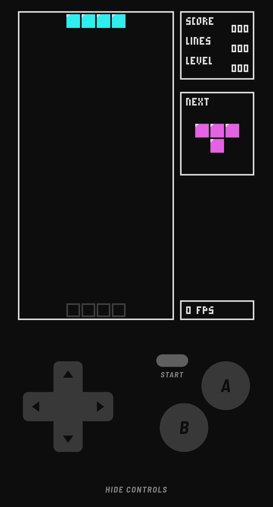

# blocks

Classic Tetris remake for the browser. Loosely based on the NES version.

## Stack

Single page React app (Vite). The game itself runs outside of React and draws on canvas.

Serverless 2 player mode is built on top of [Trystero](https://github.com/dmotz/trystero). See [src/transport.js](src/transport.js).

Starting with version 0.4.0 some of the coding is by Claude Code. The [font making script](scripts/build-font.js) is entirely by Claude Code. The sound effects were made with a sound lab built by Claude Code.

## Game Specs

- 60 game frames per second (display FPS can be higher)
- Well: 10x22 with the top 2 rows hidden
- Right-handed Nintendo Rotation System
- NES gravity table (NTSC)
- NES Randomizer
- DAS: 15 frames then a shift every 2 frames
- Spawn delay: 10 to 18 frames
- Soft drop speed: 1 row every 3 frames
- Nintendo scoring system (without pushdown points)
- Hard drop
- Ghost piece
